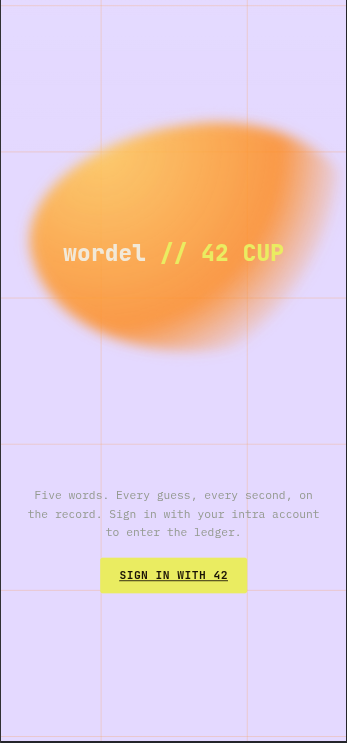
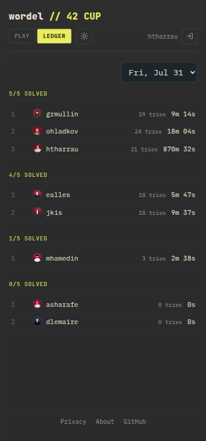
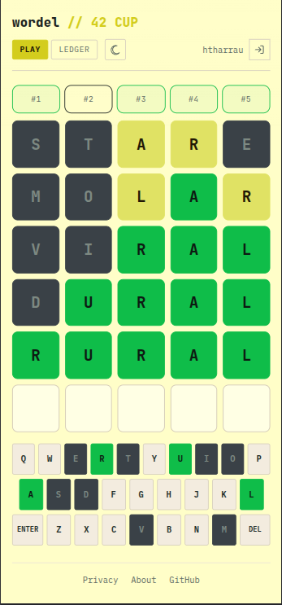

# wordel // 42 Cup

<p align="center">
  
  
  
</p>

<p align="center">
  <a href="https://wd42.xyz">Play the live game</a>
</p>

**wordel // 42 Cup** is a production word puzzle game for 42 students. Each
day, players solve a server-selected set of five words, track their time and
attempts, and compete on daily, monthly, and global leaderboards.

The project is designed as a small but complete product: it includes a public
frontend, an authenticated API, persistent game history, scheduled daily
content, guest access, anti-cheating checks, and operational caching.

## Highlights

- **Server-authoritative gameplay:** answer words never reach the browser;
  guesses are validated and scored by the backend.
- **Fair daily draws:** five words are selected with cryptographic randomness,
  while a 90-day reuse buffer prevents recent answers from repeating.
- **Real authentication flows:** players can use 42 OAuth or start a temporary
  guest session.
- **Competitive features:** per-word timing, hard mode, daily/monthly/global
  leaderboards, personal statistics, and share data.
- **Production-minded performance:** the backend and database are deployed in
  the same European region, with day-scoped draw caching, leaderboard caching,
  cache invalidation after submissions, and client-side progress caching.

## Technology

| Area | Technologies |
| --- | --- |
| Frontend | React, Vite, CSS |
| Backend | Node.js, Fastify |
| Data and auth | Supabase, PostgreSQL, 42 OAuth, JWT |
| Deployment | Vercel (frontend), Render (API), Supabase (database) |

## Architecture

```text
Browser
  │
  ├── React/Vite frontend on Vercel
  │       └── Authenticated API requests
  │
  └── Fastify API on Render
          ├── 42 OAuth and guest sessions
          ├── Server-side game and scoring rules
          ├── Daily draw generation and caching
          ├── Leaderboards, statistics, and share data
          └── Supabase/PostgreSQL
```

The active draw is keyed to the `Europe/Berlin` calendar day. The backend
stores both current and historical draws, computes timing from server
timestamps, and exposes only word metadata and per-letter feedback to the
client. Supabase service-role credentials remain exclusively on the backend.

## Repository layout

```text
backend/
  src/        Fastify API, authentication, game logic, and leaderboards
  data/       Competition pool, guess dictionary, and special-day pools

frontend/
  src/        React application, game UI, statistics, and styles

stat/
  src/        Statistics and data-story frontend

supabase/
  migrations/ Database schema and migration files

docs/
  *.png       Product screenshots used in this README
```

## Local development

### Prerequisites

- Node.js 20 or newer
- A Supabase project
- A 42 OAuth application for authenticated local development

### 1. Configure the backend

```bash
cd backend
npm install
```

Create `backend/.env` with the variables below:

```dotenv
PORT=3001
NODE_ENV=development
FRONTEND_URL=http://localhost:5173
JWT_SECRET=replace-with-a-long-random-secret
FORTYTWO_CLIENT_ID=your-42-client-id
FORTYTWO_CLIENT_SECRET=your-42-client-secret
FORTYTWO_CALLBACK_URL=http://localhost:3001/api/auth/42/callback
SUPABASE_URL=https://your-project.supabase.co
SUPABASE_SERVICE_ROLE_KEY=your-service-role-key
```

Apply the migrations in [`supabase/migrations`](supabase/migrations), then
start the API:

```bash
npm run dev
```

### 2. Start the frontend

In a second terminal:

```bash
cd frontend
npm install
```

Create `frontend/.env`:

```dotenv
VITE_API_URL=http://localhost:3001
```

Start the Vite development server:

```bash
npm run dev
```

The backend and frontend READMEs contain component-specific setup and
deployment notes:

- [Backend setup and API routes](backend/README.md)
- [Frontend setup and deployment](frontend/README.md)

## Useful commands

```bash
# Backend
cd backend
npm run dev
npm run lint

# Frontend
cd frontend
npm run dev
npm run build
npm run lint
```

## Data sources

- The competition pool is stored in
  [`backend/data/competition-words.txt`](backend/data/competition-words.txt).
- The allowed-guess dictionary is stored in
  [`backend/data/guesses.txt`](backend/data/guesses.txt), sourced from
  [tabatkins/wordle-list](https://github.com/tabatkins/wordle-list).
- Special-day pools are defined in
  [`backend/data/special.json`](backend/data/special.json).

## License

This project is open source under the MIT License. See [LICENSE](LICENSE).
